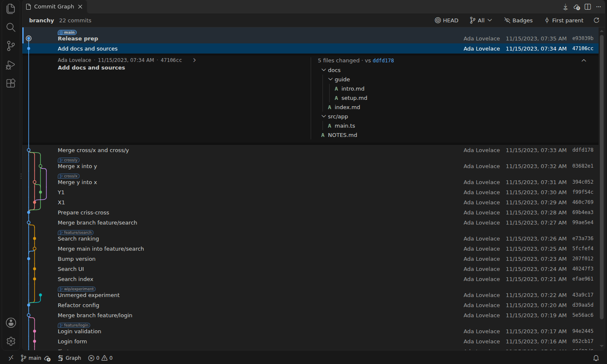

  

<h1 align="center">Strata</h1>

  A fast commit graph for git repositories in VS Code.

  
  

<!-- ci-stamp -->

## Features

- One graph of all local and remote branches, tags, stashes and HEAD, with
  badges on their commits.
- Fast on very large repositories: history loads page by page, and the Linux
  kernel opens in about 0.2 seconds once it has a commit-graph.
- Click a commit to unfold its message and changed files right under it, then
  open any file's diff.
- Checkout, merge, rebase, cherry pick, revert and reset from right-click
  menus. **Undo Last Operation** takes back all of them but a checkout.
- Create, rename, delete and push branches and tags; fetch, pull and push from
  the graph's title bar.
- Stash, apply, pop and drop stashes, shown as rows above the commits they
  were made on.
- See which branches other worktrees have checked out, open or remove them.
- Tidy recent commits before you push: edit a message in place, squash a
  Shift-click selection, fix up or drop a commit.
- Stopped at conflicts? Strata says where, opens the files and offers
  Continue, Skip and Abort.
- Hide noisy badges, such as CI tags, with patterns per repository.
- Filter the graph to some branches, remotes or tags, or follow first-parent
  history.
- Find commits by message, hash, branch name or author (<kbd>Ctrl</kbd>+<kbd>F</kbd>)
  and step through them in the graph.
- Show the history of a file or folder from the Explorer, an editor or a
  commit's changed files: the graph keeps only the commits that change it.
- **HEAD** in the toolbar jumps to the checked-out commit; rest the pointer on
  a commit's node for a card with all of its refs, the branches holding it, the
  first tag that has it and the tag it comes after.
- Several repositories in one workspace, and the graph comes back where you
  left it after a restart.
- Works locally, in WSL, over SSH and in other remote workspaces, in every
  color theme.

The [full guide](docs/guide.md) describes every view and command in detail.

## Getting started

Open the graph in any of these ways:

- Click **Graph** in the status bar. It shows the repository of the file you
  are editing.
- In the Source Control view, click the Strata button in the title bar, or
  **Open in Commit Graph** on a repository's row.
- Run **Strata: Show Commit Graph** from the Command Palette.

Click a commit to unfold its details. Right-click a commit, a badge or a stash
for what you can do with it. With several repositories open, click the
repository name at the left of the toolbar to switch.

## How to

### Hide noisy badges

Click **Badges** in the toolbar and type a pattern under **Hide badges
matching**, such as `*-rc*` (`*` matches any text, `?` one character). Press
<kbd>Enter</kbd> to hide the badges it lists. The commits stay in the graph.
You can also right-click a badge for **Hide Badge** or **Hide Similar
Badges...**.

### Undo an operation

Run **Undo Last Operation** from the graph tab's **...** menu or the Command
Palette. It puts back the last reset, merge, rebase, cherry pick or revert, a
created, renamed or deleted branch or tag, or a dropped stash. Operations that
change history or delete something also offer Undo in the notification that
reports them.

### Speed up a very large repository

If the first page of history takes long, Strata offers to write a
commit-graph file. You can also run **Strata: Write Commit-Graph for Faster
History** at any time. It only adds a cache file, the same one
`git maintenance` writes.

### Use the keyboard

With the list focused, ↑ and ↓ move the selection, <kbd>Enter</kbd> unfolds or
folds the details and <kbd>Shift</kbd>+<kbd>F10</kbd> opens the commit's menu.
In the details, ↑ and ↓ move between files and <kbd>Enter</kbd> opens the
diff.

## Requirements

- VS Code 1.90 or later.
- git installed where the repository is, with VS Code's built-in Git extension
  enabled. Changing the repository needs git 2.34 or later.

## Feedback

Report problems and requests at https://github.com/zekaizer/strata/issues.

## License

MIT. See [LICENSE](LICENSE).
